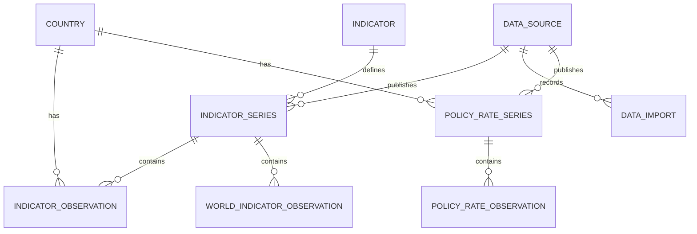

# Data model

The PostgreSQL schema is versioned with Flyway. Hibernate validates mapped entities at startup and never generates the schema.

## Entities

- **Country:** UUID, provider-compatible two- and three-character codes, localized name, original name, region, income level, capital, and optional coordinates. Aggregates are excluded during normalization. World Bank coverage includes economies and territories; provider codes should not be interpreted as a sovereignty classification. Taiwan's identity is retained from the official IMF catalog without inferring optional metadata or observations.
- **Indicator:** stable code, Portuguese label, source description, and category.
- **DataSource:** provider identity and original API/documentation URLs.
- **IndicatorSeries:** indicator, provider, dataset code, external indicator code, original name, source organization, methodological note, unit, and annual frequency. Unique by provider, dataset, and external code. WDI uses dataset `2`; OECD retains its selected dataflow and dimensions. IBGE retains its table, variable, and selected classification; BCB retains the SGS identity and explicit December selection. OECD wage and IBGE real-income price bases form part of the dataset and unit, keeping rebased observations in separate series.
- **IndicatorObservation:** country, series, year, arbitrary-precision numeric value, AVAILABLE/MISSING status, provider status, source update date, and import timestamp. Unique by country, series, and year. Unit, methodology, and source are identified through the series foreign key.
- **WorldIndicatorObservation:** the same annual value and provenance fields, with a series foreign key and no country foreign key. Unique by series and year. Its implicit scope is the World Bank's published `WLD` aggregate; these records never represent a sum or average computed from country observations.
- **DataImport:** provider, requested scope, timestamps, status, processed record count, and sanitized failure information.
- **PolicyRateSeries:** country, source, external code, native daily frequency, instrument, methodology, source organization, and scope note. Unique by country, source, and external code; distinct from annual `IndicatorSeries`.
- **PolicyRateObservation:** series, full reference date, arbitrary-precision numeric value, AVAILABLE/MISSING status, provider status, optional statistical revision date, and collection timestamp. Unique by series/date. Flyway V5 adds both policy tables without altering annual data.

Foreign keys restrict deletion. Entity references are mapped as UUIDs rather than eager object graphs. PostgreSQL enforces referential integrity. This avoids accidental relationship loading during ingestion; read models can use explicit projections when needed.

## Precision and missing values

Observations use PostgreSQL `NUMERIC` without a scale restriction and Java `BigDecimal`. JSON decimal nodes and OECD CSV decimal strings are decoded without binary floating-point conversion. OECD unit multipliers are applied exactly as declared by the source. No rounding, inflation adjustment, currency conversion, gap filling, or interpolation is performed.

National statistics use the same tables and constraints. IBGE's 0–1 Gini coefficient has its own indicator and unit, distinct from WDI's 0–100 index. IBGE real monthly household income per person is an annual survey statistic expressed in a monthly monetary unit; its base year comes from the complete published table, independently of requested interval filters. BCB's annual definition stores only the source's December record for each completed year, explicitly identified in its indicator and external code. It does not convert a partial current-year monthly series into an annual average.

A null upstream value becomes a MISSING observation. Numeric zero remains AVAILABLE. IBGE's `-` symbol denotes absolute zero; `..`, `...`, and `X` denote unavailable/suppressed cells. Those symbols are retained in `provider_status`, with zero and missing statuses assigned according to the published conventions. A year not returned by the provider is not synthesized or deleted from existing history. Validated statistical update dates are distinct from collection timestamps. Unknown update dates remain null; HTTP resource and catalog-maintenance dates are not interpreted as statistical revisions.

The World Bank often leaves its unit field empty. Units for the supported series are curated from their official definitions and retained in the catalog. An unexpected nonempty upstream unit causes the import to fail for review instead of silently mixing measurements.

## Persistence

Domain entities are JPA-mapped and validated by Hibernate. The import repository uses parameterized JDBC batches with PostgreSQL `ON CONFLICT` for efficient, atomic upserts. Both use the same datasource and Spring transaction manager; integration tests validate the JPA mappings against imported rows.

Each country catalog batch, series update, and observation page is transactional. Reusing an existing series with a different indicator, unit, or frequency is rejected; its definition must be reviewed instead of silently mixing measurements. Progress counters are committed in the same transaction as their observations. A failure preserves previously committed pages and older historical periods, and marks the run FAILED. Repeating the import safely replaces current values. This preserves historical periods, not every previous version of each revised value.

A provider-specific session-level PostgreSQL advisory lock prevents overlapping imports of the same source across processes. A new lock owner marks that provider's abandoned RUNNING executions as FAILED. No long database transaction is held while contacting a provider. World and country observations update the same execution's progress counter within their respective batch transactions.

Observations are indexed by series/year/value for analytical queries, with a unique index covering country/series/year histories. Import history is indexed by provider/start time.

IBGE and BCB imports require Brazil in the operational scope and write only Brazilian observations. Their national comparison policy and country-summary visibility are enforced in the query layer, without adding user entities, provider-specific observation tables, or a separate schema for each source. Explicit historical queries for another country remain empty. The [Brazilian adapter reference](integrations/brazil.md) documents the selected definitions.

Daily policy-rate definitions share one provider-independent model across BCB, BIS, and NBU. They reuse the source catalog and import audit, with transactional per-country definition/observation/progress upserts. Daily keys preserve source dates; no annual average or fabricated calendar expansion is stored. The annual BCB household-debt model and definition remain unchanged. See the [policy-rate reference](integrations/policy-rates.md).
