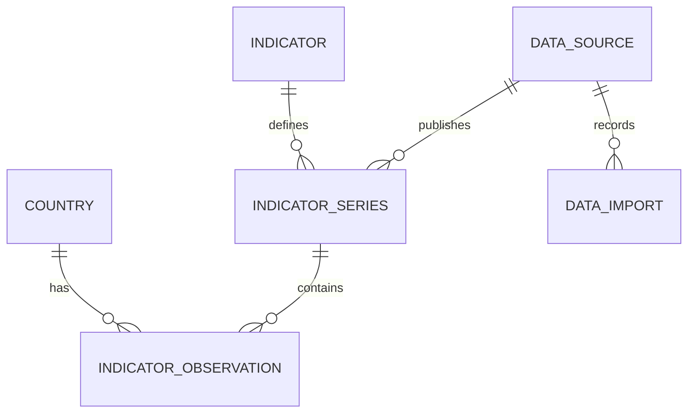

# Data model

The PostgreSQL schema is versioned with Flyway. Hibernate validates mapped entities at startup and never generates the schema.

## Entities

- **Country:** UUID, provider-compatible two- and three-character codes, localized name, original name, region, income level, capital, and optional coordinates. Aggregates are excluded during normalization. World Bank coverage includes economies and territories; provider codes should not be interpreted as a sovereignty classification.
- **Indicator:** stable code, Portuguese label, source description, and category.
- **DataSource:** provider identity and original API/documentation URLs.
- **IndicatorSeries:** indicator, provider, dataset code, external indicator code, original name, source organization, methodological note, unit, and frequency. Unique by provider, dataset, and external code. The initial dataset is WDI (`2`) with annual frequency.
- **IndicatorObservation:** country, series, year, arbitrary-precision numeric value, AVAILABLE/MISSING status, provider status, source update date, and import timestamp. Unique by country, series, and year. Unit, methodology, and source are identified through the series foreign key.
- **DataImport:** provider, requested scope, timestamps, status, processed record count, and sanitized failure information.

Foreign keys restrict deletion. Entity references are mapped as UUIDs rather than eager object graphs. PostgreSQL enforces referential integrity. This avoids accidental relationship loading during ingestion; read models can use explicit projections when needed.

## Precision and missing values

Observations use PostgreSQL `NUMERIC` without a scale restriction and Java `BigDecimal`. Numeric JSON values are decoded directly as decimal nodes. No rounding, inflation adjustment, currency conversion, gap filling, or interpolation is performed.

A null upstream value becomes a MISSING observation. Numeric zero remains AVAILABLE. A year not returned by the provider is not synthesized or deleted from existing history. Update dates supplied by the source are distinct from collection timestamps.

The World Bank often leaves its unit field empty. Units for the supported series are curated from their official definitions and retained in the catalog. An unexpected nonempty upstream unit causes the import to fail for review instead of silently mixing measurements.

## Persistence

Domain entities are JPA-mapped and validated by Hibernate. The import repository uses parameterized JDBC batches with PostgreSQL `ON CONFLICT` for efficient, atomic upserts. Both use the same datasource and Spring transaction manager; integration tests validate the JPA mappings against imported rows.

Each country catalog batch, series update, and observation page is transactional. Reusing an existing series with a different indicator, unit, or frequency is rejected; its definition must be reviewed instead of silently mixing measurements. Progress counters are committed in the same transaction as their observations. A failure preserves previously committed pages and older historical periods, and marks the run FAILED. Repeating the import safely replaces current values. This preserves historical periods, not every previous version of each revised value.

A session-level PostgreSQL advisory lock prevents overlapping World Bank imports across processes. A new lock owner marks abandoned RUNNING executions as FAILED. No long database transaction is held while contacting the provider.

Observations are indexed by series/year/value for analytical queries, with a unique index covering country/series/year histories. Import history is indexed by provider/start time.
